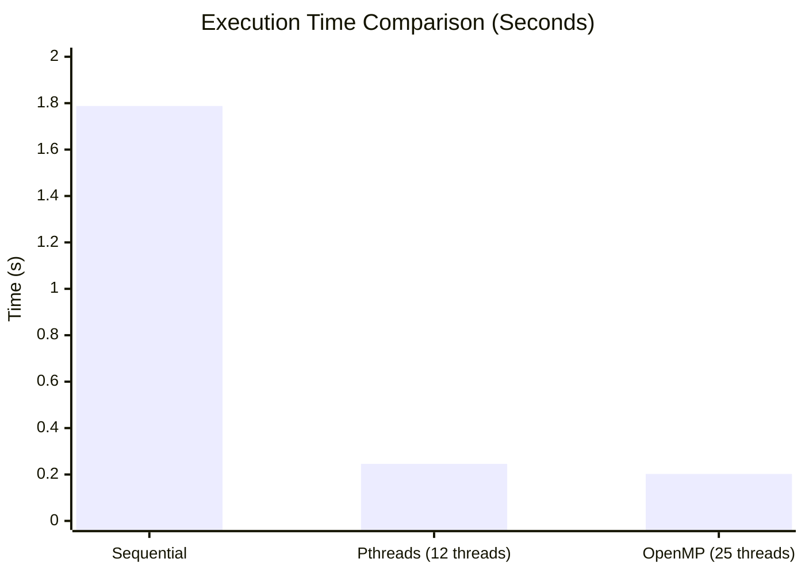

# C Multithreading Lab: Pthreads and OpenMP

## 1. Aim
To understand and implement multithreading in C using the POSIX Threads (Pthreads) library and the OpenMP API. The lab explores thread creation, parallel execution, race conditions, synchronization mechanisms (mutexes, critical sections), and performance evaluation comparing sequential versus parallel execution.

## 2. Overview
This repository contains a collection of C programs demonstrating multithreading concepts. The project is divided into two main parts:
- **Pthreads:** Low-level thread management and synchronization using mutexes.
- **OpenMP:** High-level, compiler-directive-based parallelization using pragmas.
The experiments highlight the non-deterministic nature of thread execution, the occurrence of race conditions when accessing shared resources, and the methods to resolve them.

## 3. Technologies Used
- **Language:** C
- **Libraries/APIs:** Pthreads, OpenMP
- **Environment:** WSL Ubuntu
- **Compiler:** GCC (GNU Compiler Collection)

## 4. Pthreads Experiments
- `thread1.c` / `thread2.c`: Basic thread creation and joining.
- `thread_sum.c`: Parallel computation using threads.
- `race.c`: Demonstrates a race condition where multiple threads increment a shared counter without synchronization.
- `mutex.c`: Solves the race condition using `pthread_mutex_t` to ensure mutual exclusion.
- `pthread_perf.c`: Measures the performance (execution time) of multithreaded computation.

## 5. OpenMP Experiments
- `omp1.c`: Basic OpenMP parallel regions.
- `omp_sum.c`: Parallel loop computation using `#pragma omp parallel for`.
- `omp_race.c`: Demonstrates a race condition in OpenMP without synchronization.
- `omp_critical.c`: Resolves the race condition using `#pragma omp critical`.
- `omp_barrier.c`: Demonstrates thread synchronization using barriers.
- `omp_perf.c`: Measures performance of OpenMP parallel execution.

## 6. Race Condition and Synchronization Explanation
A **race condition** occurs when multiple threads attempt to read and write to a shared memory location simultaneously, leading to unpredictable and incorrect results. Because thread execution order is **nondeterministic**, the final value of the shared resource depends on the precise timing of the threads' instructions.

To prevent race conditions, **synchronization** is required:
- **Mutex (Pthreads):** A lock that ensures only one thread can access the critical section at a time.
- **Critical Section (OpenMP):** A directive (`#pragma omp critical`) that restricts code block execution to a single thread at a time.

## 7. Performance Analysis
Parallelizing a task generally reduces execution time by dividing the workload among multiple threads. The performance gain depends on the number of threads and the nature of the computation. In these experiments, both Pthreads and OpenMP significantly outperformed the sequential approach.

## 8. Actual Experimental Results

### Synchronization Results (Target: 400,000)

| Experiment | Expected Result | Actual Result | Status |
| :--- | :--- | :--- | :--- |
| Pthreads Race | 400000 | 141792 | ❌ Data Loss (Race Condition) |
| Pthreads Mutex | 400000 | 400000 | ✅ Synchronized |
| OpenMP Race | 400000 | 100090 | ❌ Data Loss (Race Condition) |
| OpenMP Critical | 400000 | 400000 | ✅ Synchronized |

### Execution Time Results

| Implementation | Threads | Result | Execution Time (Seconds) |
| :--- | :--- | :--- | :--- |
| Sequential | 1 | 499999999500.00 | 1.787701 |
| Pthreads | 12 | (Matches Sequential) | 0.245800 |
| OpenMP | 25 | (Matches Sequential) | 0.202376 |

*(Note: Thread execution order is nondeterministic.)*



## 9. Compilation and Execution Commands

**For Pthreads:**
```bash
gcc -pthread filename.c -o output_name
./output_name
```

**For OpenMP:**
```bash
gcc -fopenmp filename.c -o output_name
./output_name
```

## 10. Repository Structure
```text
Multithreading-Pthreads-OpenMP/
├── README.md
├── pthreads/
│   ├── thread1.c
│   ├── thread2.c
│   ├── thread_sum.c
│   ├── race.c
│   ├── mutex.c
│   └── pthread_perf.c
├── openmp/
│   ├── omp1.c
│   ├── omp_sum.c
│   ├── omp_race.c
│   ├── omp_critical.c
│   ├── omp_barrier.c
│   └── omp_perf.c
├── results/
├── screenshots/
└── docs/
```

## 11. Key Observations
1. **Race Conditions:** Without synchronization, the shared counter falls significantly short of the expected 400,000 (e.g., 141,792 and 100,090), proving that concurrent memory accesses overwrite each other.
2. **Synchronization Overhead:** Mutexes and critical sections successfully ensure data integrity (achieving exactly 400,000), but introduce wait times for threads.
3. **Speedup:** Pthreads (12 threads) achieved an ~7.27x speedup over the sequential implementation. OpenMP (25 threads) achieved an ~8.83x speedup.
4. **Nondeterminism:** The order in which threads execute and complete is not predictable, underscoring the need for proper synchronization mechanisms.

## 12. Conclusion
This lab successfully demonstrates the practical implementation of multithreading in C. OpenMP provides a simpler, higher-level interface for parallelizing loops, while Pthreads offers more granular control over thread management. Both APIs effectively reduce execution time for parallelizable tasks, provided that shared resources are properly protected against race conditions using synchronization techniques.
